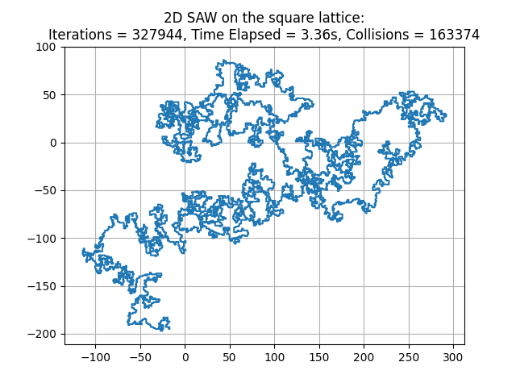

# Self-Avoiding Walks: Generation and Monte Carlo Simulation

## Overview

A learning project exploring **self-avoiding walks (SAWs)** on lattice structures, with an emphasis on high-performance computing and Monte Carlo methods. The goal is to generate large numbers of walks, study their statistical properties, and eventually investigate scaling laws and critical exponents.

## How It Works

1. **Generate walks:** Construct self-avoiding walks by randomly extending a path and backtracking when a collision occurs.
2. **Calculate statistics:** Measure properties such as end-to-end distance and radius of gyration.
3. **Accumulate samples:** Repeatedly generate walks and incrementally update statistical estimates.
4. **Parallelize computation:** Use multiple processes to generate independent samples simultaneously.
5. **Manage data safely:** Save results in NumPy files, using temporary files and atomic replacements to reduce the risk of data corruption if execution is interrupted.

## Example plot

The following plot shows a generated SAW on the 2D square lattice of length 10,000.



## Main Functions

- `get_SAW_naive_v1(...)` — Generates walks using lists and floating-point coordinate comparisons.
- `get_SAW_naive_v2(...)` — A more efficient implementation using integer-coordinate tuples and sets to track visited vertices.
- `backtrack_num(t)` — Randomly determines how far to backtrack after a collision.
- `plot_SAW(x)` — Visualizes a generated walk in 2D or 3D.
- `ete_dist(x)`, `rad_gyr(x)`, `mean_ete_dist(x)` — Calculate statistical properties of a walk.
- `save_data(...)` and `pool_stats(...)` — Incrementally accumulate and combine statistics across samples.
- `initiate_processes(...)` — Launches multiple processes to generate walks in parallel.
- `finish_pooling()` and `delete_tmp()` — Help recover from interrupted data pooling or saving operations.

## Running the Script

**Requirements:** Python 3, NumPy, and Matplotlib, plus the project's `lattices.py` module.

Run the main script with:

```bash
pip install numpy matplotlib
python main.py
```

The code at the bottom of the script determines whether existing data is pooled or new sampling processes are started. Review these settings before running.

## Future Improvements

- Implement more advanced SAW generation algorithms, such as the pivot algorithm, to improve sampling efficiency for longer walks.
- Expand Monte Carlo sampling and investigate scaling laws and scaling exponents relating walk length to statistical properties.
- Optimize statistical calculations, particularly those involving repeated calculations over truncated walks.
- Improve parallel data collection, checkpointing, and recovery for long-running computations.
- Add analysis and visualization tools to compare lattices, walk lengths, and sampling statistics.

